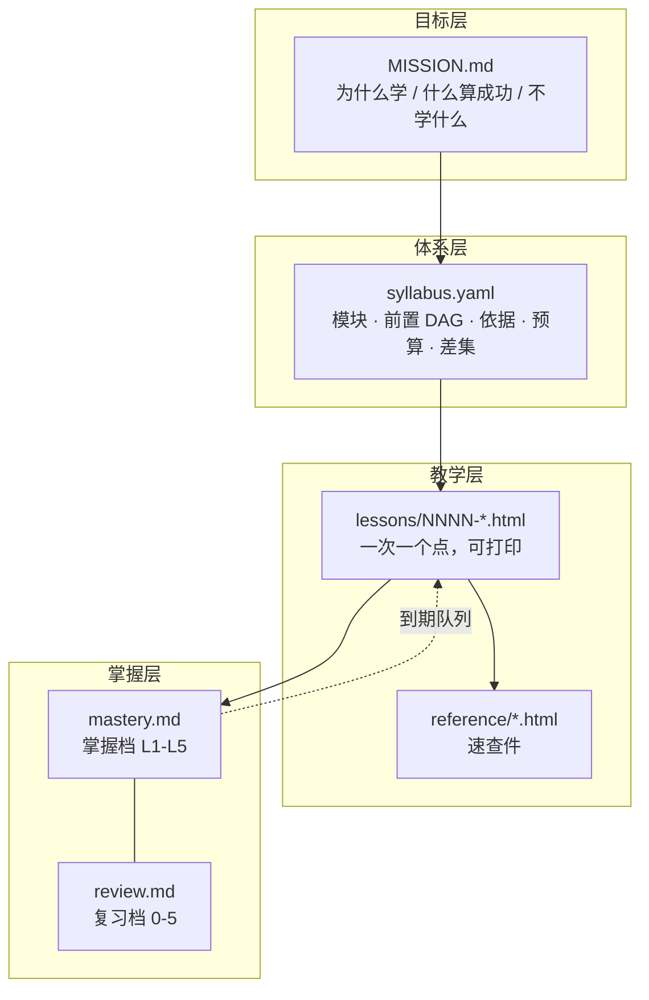
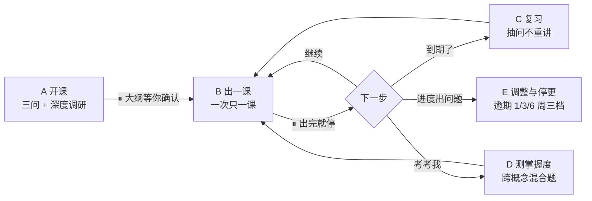
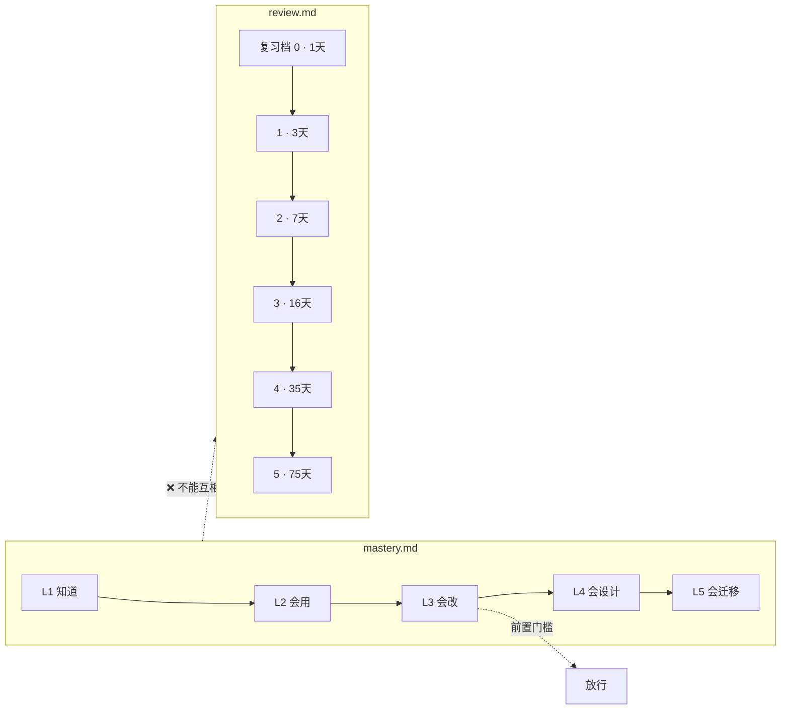
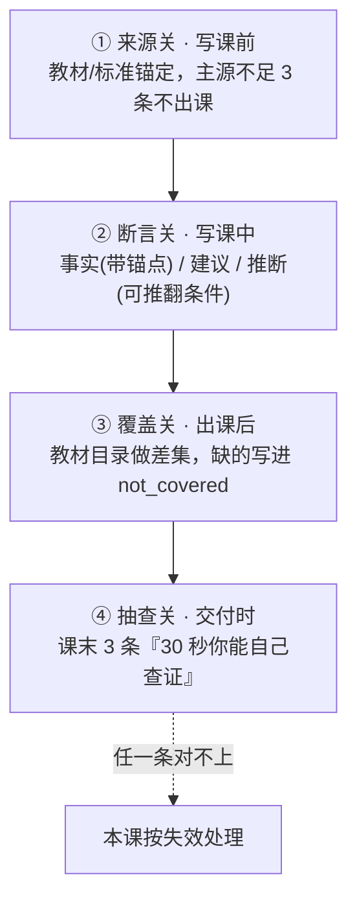

# learn-system

**体系化学习任意领域的 Skill**：先建带前置依赖的大纲，再一课一产出（HTML 课 + 速查件），每课记录概念级掌握度并调度复习，走到 M05 闭环。

> 版本：v0.6.0　|　许可：MIT　|　适用：Claude Code / Codex / WorkBuddy 等支持 `SKILL.md` 的 Agent

**一句话**：没有它，你问「教我 X」，AI 讲一段，你听着有道理，三周后忘了，也说不清自己学到哪。有它，你说「系统学 X」，它先跟你敲定目标与 12 个模块的前后依赖，然后一周一课地推，每课留下一个能打印的页面和一行掌握度，到期了主动提醒你「今天该复习这 3 个」。

---

## 一、它到底解决什么

| | 普通提问 | learn-system |
|---|---|---|
| 状态在哪 | 聊天记录里，换会话就没了 | `study/<topic>/` 的 5 个文件里 |
| 学到哪了 | 靠感觉 | `mastery.md` 每个概念一个 L1-L5 档位，带证据和判定方 |
| 哪块薄弱 | 不知道 | 概念级，可排序，复练只练薄弱点 |
| 会不会忘 | 会 | `review.md` 按复习档 0-5 排期，到期就抽问 |
| 顺序对不对 | 想到哪学到哪 | `syllabus.yaml` 前置依赖 DAG，前置没到 L3 不放行 |
| 知识可不可信 | 无法判断 | 四关：来源 / 断言 / 覆盖 / 抽查 |

**它的定位是控制层，不是内容生成器。** 动画、整域手册、交互课件分别建议切到 `visual-knowledge-tutor`、`knowledge-handbook-builder`、`teachany`。它只做那件别的 skill 都不做的事：**跨多轮推进，并且始终知道你在哪、哪块薄弱、下次该复习什么**。

---

## 二、概念图

### 1. 四层状态，每层都有落盘文件



### 2. 主流程五步，中间两个停点



两个停点是整个设计的核心：**AI 不许一口气把课刷完**。批量生成的课最容易把掌握度表刷成空的，那等于没学。

### 3. 两个刻度，不通约



**最容易犯的错**：把这两个数值互相抄。`mastery.md` 是学到什么程度，`review.md` 是多久后复习，两者不通约。

### 4. 知识正确性四关



它**不承诺知识正确**——模型无法自证正确，承诺正确只会得到更自信的编造。它承诺的是：把「这课可不可信」变成你 30 秒内能自己判断的事。

---

## 三、安装

```bash
# 方式一：解压到 skills 目录（推荐）
unzip learn-system-v0.6.0.zip -d ~/.workbuddy/skills/
# 结果：~/.workbuddy/skills/learn-system/

# 方式二：从源码复制
cp -r skill/learn-system ~/.workbuddy/skills/
```

零外部依赖，纯 Markdown + HTML。卸载直接删目录。

---

## 四、用法

### 触发词

| 你说 | 走哪条流程 |
|---|---|
| 系统学 X / 入门 X / 制定学习路线 | A 开课 |
| 继续 / 下一课 / 下一篇 | B 出一课 |
| 复习 / 该复习什么 | C 复习 |
| 考考我 / 我学到哪了 | D 测掌握度 |
| 太浅了 / 太难 / 赶不上 / 太久没学 | E 调整与停更 |

### 五个文件（起步只建 5 个，其余按需生长）

```text
study/<topic>/
├── MISSION.md          # 为什么学 · 什么算成功 · 不学什么
├── syllabus.yaml       # 模块 · 前置 DAG · 依据 · 验收 · 知识基准 · 差集
├── mastery.md          # 掌握档 L1-L5（唯一恢复入口，顶部三行）
├── review.md           # 复习档 0-5 · 到期队列
├── lessons/*.html      # 单文件、可打印、带即时判分自检
├── reference/*.html    # 速查件（按需）
├── mistakes.md         # 同一概念累计 2 次错才建（按需）
└── learning-records/   # 目标或大纲变更时才建（按需）
```

### 三条最容易踩的坑

1. **不要在聊天里留状态。** 聊天是入口，文件是事实。换会话、关电脑、隔一个月回来，靠的是 `mastery.md` 顶部三行。
2. **答完自检才给档位。** 没答就是「已上未评」，AI 不会自评升档（铁律 17）。
3. **到期日一律用命令算**（`date +%F`），不心算——手算已实测出过错。

---

## 五、20 个使用实例

| # | 你说 | 它做什么 | 产出 |
|---|---|---|---|
| 1 | 系统学 注塑 | 弹窗三问（为什么学/什么算成功/每周几小时）→ 教材+标准调研 → 出大纲等你确认 | 5 个文件 + 带前置依据的大纲 |
| 2 | 我要学 Rust，为了能读懂别人的代码 | 按「能读懂」而非「会写」剪大纲，编译原理、借用检查保留，异步生态放入 not_covered | 目标导向的大纲 |
| 3 | 继续 | 读顶部三行 → 出下一课 → 停下 | 一节 HTML 课 + 更新掌握度 |
| 4 | 复习 | 先报「今天到期 N 条」→ 抽问（不重讲）→ 三档评级 | 复习档升降 + 新到期日 |
| 5 | 考考我 | 跨概念混合题（不是逐概念各一题）→ 重定档 | 掌握档表 + 三个最薄弱点 |
| 6 | 我读完了，保压那段没懂 | 把那段记为下一课要补的内容 | 补一课 or 在原课加一节 |
| 7 | 太浅了，加一节讲浇口冻结 | 走 E：改 syllabus，加模块并补前置依据 | 大纲 v2 + learning-record |
| 8 | 太久没学了 | 停更三档判定（逾期 1 周砍模块 / 3 周改判据 / 6 周归档） | 明确处置，不假装还在学 |
| 9 | 把「注射压力与保压」拆成两课 | 拆课但 `mastery.md` 仍只占一行 | 两课 + 概念粒度不变 |
| 10 | 我有厂里的工艺卡和缺陷图册 | 升为级 0 一手材料，优先级压过所有网络来源 | 大纲以你的材料为准 |
| 11 | 系统学 木门结构与工艺 | 强监管领域：现行 GB/ISO 标准优先于教材 | 以标准为准的大纲 |
| 12 | 系统学 Tauri | 快变领域：官方器文档目录做骨架，教材只作概念框架 | 以官方文档为准的大纲 |
| 13 | 三个月后考证，帮我备考 | 切 exam 模式：高频测验 + 更短的复习间隔 | 高频节奏的大纲 |
| 14 | 我每周只有 2 小时 | 按 2h × 周数重算预算，超 80% 就砍模块 | 收缩后的大纲 |
| 15 | 讲透「熔接痕」这个概念 | **建议切** `visual-knowledge-tutor`；切不成本 skill 用 ASCII 图讲透 | 单点讲解（不建体系） |
| 16 | 我换工作了，目标变了 | 必须先改 MISSION 再改大纲，并记 learning-record | 新 MISSION + 大纲 v2 |
| 17 | 把这门课导成一份手册 | **建议切** `knowledge-handbook-builder`；切不成用 `reference/` 出速查件 | 速查件或手册 |
| 18 | 我出差两周没学 | 逾期处置：抽查 1 题再定档，不动声色继续 | 降档或维持 + 说明 |
| 19 | 「收缩率」我老记不住 | 累计错 2 次 → 建 `mistakes.md`，记错因与语境 | 错因本 + 换语境复练 |
| 20 | 用我这份内部教材做骨架 | 以你的教材目录做基准，做差集 | 贴合你们体系的大纲 |

---

## 六、知识正确性：四关怎么落地

| 关 | 时机 | 硬规则 | 失败信号 |
|---|---|---|---|
| 来源关 | 写课前 | 稳定学科用教材目录+课标；快变领域用官方文档；强监管用现行标准。主源不足 3 条可开链接**不得出课** | 来源区空着就开始讲 |
| 断言关 | 写课中 | 每句事实分三级：事实（带小节级来源锚点）/ 建议 / 推断（带可推翻条件）；单源标「单源」 | 某小节没有锚点 |
| 覆盖关 | 出课后 | 教材目录做差集；每个 `concepts` 必须出现在某课；每模块写「不覆盖什么」 | 有概念从没讲过 |
| 抽查关 | 交付时 | 课末固定「30 秒内你能自己查证的三条」，附查证方法 | 你抽一条对不上 → 整课失效 |

来源优先级（6 级）：**级 0 你的一手材料 > 级 1 现行标准 > 级 2 官方文档 > 级 3 教材/课标 > 级 4 权威课程 > 级 5 最佳实践**。第 4-5 级不得用于支撑定义与原理；教材与现行标准冲突时**标准优先**。

---

## 七、校验与开发

```bash
python tools/audit.py     # 69 项机器校验，退出码非 0 即存在 FAIL
python build.py           # 递增版本号 → 同步三份文档 → 打 dist/*.zip
python build.py --bump minor
```

`tools/audit.py` 覆盖：包完整性、frontmatter、**17 条铁律交叉引用是否指对**、跨文件术语一致、`syllabus` 结构（DAG 无环/预算/字段）、模板无断链、工作区产物（课/速查/掌握度/复习/日期算术/口径一致）、HTML 合法性。

完整设计记录见 `docs/TECHNICAL.md`（含四轮对抗性审查的 16 个缺陷与修复）。

---

## 八、明确不做

- 不做动画 / 交互课件 / 知识图谱（建议切 `visual-knowledge-tutor`、`teachany`）
- 不做 FSRS 精确调度（用简化的复习档 0-5，够用且零依赖）
- 不做推送提醒（进入 skill 时第一句报到期数）
- 不接管 `teach` 的状态（产物物理隔离在 `study/<topic>/`）
- 不承诺知识正确（承诺错误可被发现）

---

## 九、许可

MIT。
