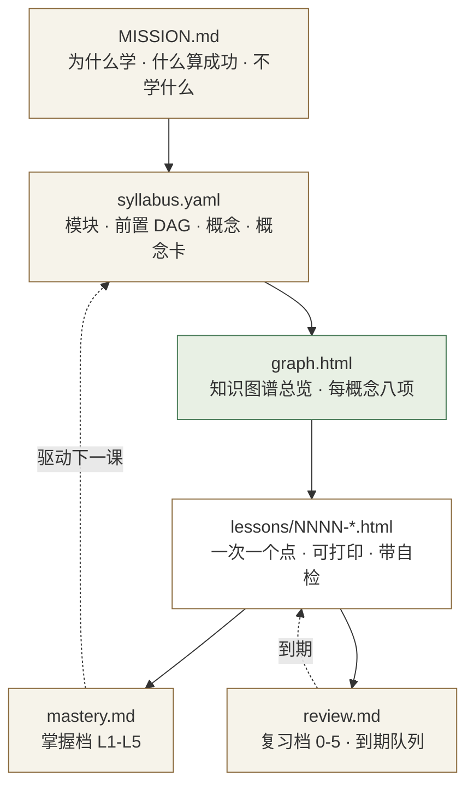
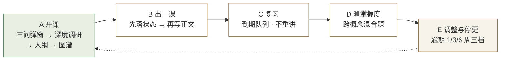
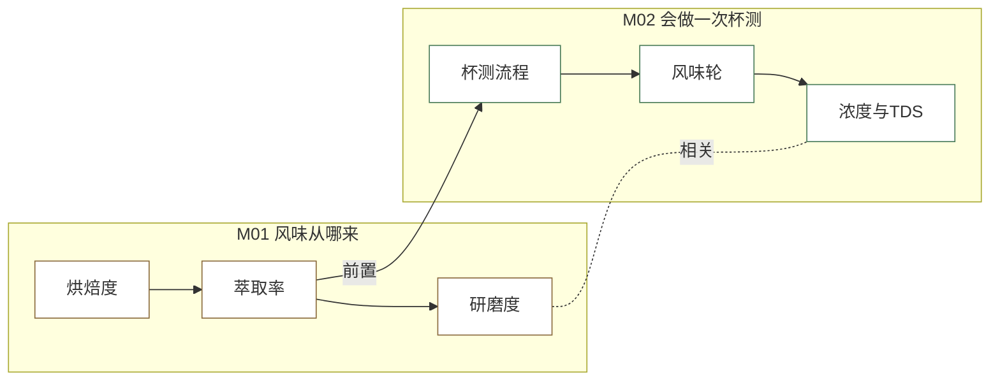
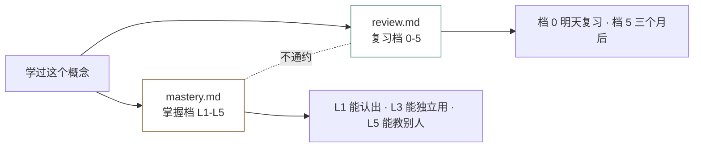

# learn-system

**一个把「随便学学」变成「有图谱、有前置、有验收」的学习控制层。**

版本：v0.8.0　|　许可：MIT　|　适用：Claude Code / Codex / WorkBuddy 等支持 `SKILL.md` 的 Agent

[用户手册](docs/USER_GUIDE.md) · [技术手册](docs/TECHNICAL.md) · [Releases](../../releases)

---

## 一、它解决什么问题

你可能已经有很多「讲解型」的 AI 技能，但它们都有同一个毛病：**每次都从头开始**。

| 痛点 | learn-system 的解法 |
|---|---|
| 今天讲的明天忘，AI 也不知道你学到哪了 | 状态落在文件里，**`mastery.md` 顶部三行**就是全部恢复入口 |
| 讲得挺顺，但不知道自己在整张网的哪个位置 | 开课时先出**知识图谱总览**：每个概念的前置是谁、和谁相关 |
| 学完不知道算不算学会 | 每课有零提示自检 + 掌握档判据 + 复习队列，**没证据不给档位** |
| 知识点之间没有依赖，学到后面发现前面缺一块 | 大纲带**前置 DAG**，每个前置必须写「缺了它你会卡在哪」 |

它**不生产知识**，它管的是：学什么、按什么顺序、到什么程度、什么时候该复习。

---

## 二、四层结构（概念图）



**聊天是入口，文件是事实。** 换会话、关电脑、隔一个月回来，靠的是文件不是记忆。

---

## 三、五个环节（概念图）



说话就能进：说「我想系统学 X」走 A，说「继续」走 B，说「该复习什么」走 C。

---

## 四、知识图谱：每个概念八项（概念图）

大纲告诉你**学什么**，图谱告诉你**它们之间是什么关系、每个点到底是什么**。



实线箭头 = **前置**（先学它才懂），虚线 = **相关**（互相影响 / 常一起调 / 易混淆）。

每个概念必须有这 **八项**，缺一项不算覆盖（铁律 18）：

| # | 项 | 合格判据 | 糊弄的样子 |
|---|---|---|---|
| 1 | **前置** `prereq` | 写概念名，可跨模块；确实无前置写 `[]` | 把整个模块当地前置 |
| 2 | **相关** `related` | 说清是互相影响 / 常一起用 / 易混淆 | 把 related 写成 prereq |
| 3 | **前提假设** `assumption` | 「前提是 ___；不成立会 ___」 | 只写「假设理想状态」 |
| 4 | **第一性原理** `first_principle` | 追到一个不再追问的定律/守恒律 + 推导方向 | 停在「经验上就是这样」 |
| 5 | **通俗说明** `plain` | 生活类比，且**对齐机制**不是只对齐表象 | 「就像开车」 |
| 6 | **扩展** `extend` | 指向具体技术/章节 | 写「深入学习」 |
| 7 | **2D 图示** | 内联 SVG：流程 / 对比 / 剖面 / 曲线 | 外链图片 |
| 8 | **3D 图示** | 内联等距（isometric）SVG 或 CSS 3D | 外链 Three.js（断网就白图） |

产物：`study/<topic>/graph.html`（单文件、离线可开、可打印）+ `syllabus.yaml` 里的 `concept_cards`（6 个内容字段）。

---

## 五、两个刻度不能混（概念图）



**「学会了多少」和「多久会忘」是两件事。** 掌握档不换算成复习档，也不互相推导。

---

## 六、安装

```bash
# 方式一：解压 zip（推荐）
unzip learn-system-v0.8.0.zip -d ~/.workbuddy/skills/
# Windows: 解压到 C:\Users\<你>\.workbuddy\skills\

# 方式二：从仓库复制
git clone https://github.com/Asaceoo/learn-system-skills.git
cp -r learn-system-skills/skill/learn-system ~/.workbuddy/skills/
```

装完说一句「我想系统学 XXX」就会触发。

---

## 七、用法

### 7.1 第一次用：会经历什么

1. **弹窗三问**（为什么学 / 什么算成功 / 每周几小时）→ 选代号，点确认
2. 它去**深度调研**：2 个独立教材目录 + 1 份课程标准，关键结论做 ≥2 源交叉
3. 出 **3-12 个模块的大纲**，每模块带前置依据、验收、不覆盖什么 → 你确认
4. 出**知识图谱总览**：每个概念八项 + 依赖图 → 你确认
5. 出**第一课**，之后一课一课走

### 7.2 说话就能用

| 你说 | 走 | 它做什么 |
|---|---|---|
| 我想系统学 X / 入门 X | A 开课 | 弹窗三问 → 调研 → 大纲 → 图谱 |
| 继续 / 下一课 | B 出一课 | 先落状态再写正文，交课前 7 项打勾贴证据 |
| 我读完了 + 讲感受 | B 收尾 | 回填掌握档（有证据才升） |
| 该复习什么 / 复习 | C 复习 | 先报「今天到期 N 条」，不重讲 |
| 考考我 / 我学到哪了 | D 测掌握度 | 跨概念混合题 |
| 太浅了 / 太难 / 赶不上 | E 调整 | 改大纲，记 learning-record |
| 太久没学了 | E 停更判定 | 逾期 1/3/6 周三档处置 |
| 讲透这个概念（单点） | 切 `visual-knowledge-tutor`；切不成见降级表 | 不建 `study/`，单点讲透即止 |

### 7.3 开课弹窗

没有 `MISSION.md` 时会弹一张卡，三问，每问几个可点选项：

```text
Q1 为什么学？      A1 工作马上用   A2 转岗求职   A3 兴趣通识
Q2 什么算成功？    B1 做出东西     B2 通过考试   B3 讲明白
Q3 怎么学+几小时？ C1 标准  C2 备考   ·   D1 每周1-3  D2 4-6  D3 7+
                   → 汇总行：A1 B3 C1 D2　·　注塑
```

点「确认，开课」直接把这串代号发回对话。不点也不卡住——说「直接开始」会按默认值开课，随时可改。
答完立刻写进 `MISSION.md`，**下次不再问**。

### 7.4 它怎么找到你学到哪了

这是最容易出错的一步，规则写死：

- 扫**当前工作目录**下的 `study/*/mastery.md`，和兜底目录 `~/Documents/learn-system/*/mastery.md`
- **不向上级目录找**——否则在仓库或多项目目录下会误命中别人的课题
- 唯一命中直接用；**多个命中列表让你选，不靠文件时间戳自己猜**

### 7.5 文件结构（起步只建 5 个，其余按需生长）

```text
study/<topic>/
├── MISSION.md          # 为什么学 · 什么算成功 · 不学什么
├── syllabus.yaml       # 模块 · 前置 DAG · 概念 · 概念卡 · 验收 · 知识基准
├── graph.html          # 知识图谱总览（每概念八项 + 依赖图）
├── mastery.md          # 掌握档 L1-L5（唯一恢复入口，顶部三行）
├── review.md           # 复习档 0-5 · 到期队列
├── lessons/*.html      # 单文件、可打印、带即时判分自检
├── reference/*.html    # 速查件（按需）
├── mistakes.md         # 同一概念累计 2 次错才建（按需）
└── learning-records/   # 目标或大纲变更时才建（按需）
```

### 7.6 三条最容易踩的坑

1. **不要在聊天里留状态。** 聊天是入口，文件是事实。
2. **答完自检才给档位。** 没答就是「已上未评」，AI 不会自评升档（铁律 17）。
3. **到期日一律用命令算**（`date +%F`），不心算——手算已实测出过错。

---

## 八、20 个使用实例

| # | 你说什么 | 它做什么 | 你拿到什么 |
|---|---|---|---|
| 1 | 我想系统学 注塑 | 弹窗三问（代号 A/B/C/D，点确认回传）→ 教材+标准调研 → 大纲 → 图谱 | 5 个文件 + 带前置依据的大纲 + 26 概念图谱 |
| 2 | 继续 | 先定位进度（两个位置都扫、不向上找）→ 先落状态再写正文 | 一个可打印的 HTML 课 + 自检题 |
| 3 | 我读完了，但冷却时间那段没看懂 | 回到那个概念重讲，**不重出整课** | 一段补充说明 + 更新后的掌握档 |
| 4 | 我答完了，第 3 题错了 | 按证据表回填掌握档，记错误 | L2 + 证据 + 一条复习入队 |
| 5 | 该复习什么 | 先报「今天到期 4 条」，按逾期最久排序 | 4 道抽问题（不重讲） |
| 6 | 考考我 | 跨概念混合题，覆盖记忆/理解/应用/迁移 | 8-10 题 + 三个最薄弱点 |
| 7 | 我学到哪了 | 读 mastery.md 顶部三行 + 掌握档表 | 一张进度表 + 下一课是什么 |
| 8 | 太浅了 | 改大纲：加深度或换模块，记 learning-record | 修订后的大纲 |
| 9 | 赶不上，每周只能 1 小时了 | 重算预算 → 砍模块而不是压缩单模块 | 缩减版大纲 + 新到期日 |
| 10 | 我一个月没学了 | 逾期判定：3 周 → 改判据 | 一条明确处置，不假装还在学 |
| 11 | 给我看看这门课的图谱 | 渲染 graph.html：依赖图 + 每概念八项 | 一张能打印的知识地图 |
| 12 | 冷却时间的前提假设是什么 | 读概念卡 `assumption` 字段 | 一句话前提 + 不成立会怎样 |
| 13 | 冷却时间用第一性原理讲一遍 | 读 `first_principle`：追到 Fourier 定律 | 从定律推到结论的链条 |
| 14 | 讲得再通俗点 | 换一个**对齐机制**的类比（不是换个说法） | 一个生活类比 |
| 15 | 这个概念学完能往哪走 | 读 `extend` 字段 | 具体技术/章节，不是「深入学习」 |
| 16 | 把图谱导成 PDF | 浏览器打印 graph.html（已做 print 样式） | 一份 PDF 知识地图 |
| 17 | 帮我把这门课导成手册 | **建议切** `knowledge-handbook-builder`；切不成用 `reference/` 出速查件 | 速查件或手册 |
| 18 | 我在另一个目录下说「继续」 | 扫当前目录 + 兜底目录，不向上找；多个命中会问你 | 找回原来的课题，不会重开 |
| 19 | 接管我之前的 teach 进度 | 检测到 signals 且无 syllabus.yaml 时问一句，接管后把旧资产当已有 | 继承的 lessons + records |
| 20 | 这个知识点你确定对吗 | 断言分级：事实带锚点 / 建议标明 / 推断带可推翻条件 | 每句都有级别，能查证 |

---

## 九、知识正确性怎么保证（四关）

**不能保证「绝对正确」，但能让错误便宜地被发现。**


| 关 | 做什么 |
|---|---|
| **来源关** | 级 0 一手材料（你的工艺卡/检测报告）> 级 1 现行标准 > 级 2 官方文档 > 级 3 教材课标 > 级 4 权威课程 > 级 5 最佳实践。找不到来源标「待核验」，**不许编** |
| **断言关** | 事实要带小节级锚点；建议要标明是建议；推断要写出**可推翻条件** |
| **覆盖关** | 拿 2 个独立教材目录做差集，教材有而没讲的写进 `coverage_gap` 并给理由 |
| **抽查关** | 交付前随机抽 3 条回原文核对，不一致就改 |

**「全面」的重新定义**：声明范围内全覆盖 + 边界外明确声明（`not_covered`）。不是「什么都讲了」。

---

## 十、自检：154 项审计

```bash
python learn-system-audit.py       # 主审计：154 项（含 T 弹窗 / V 图谱 / X 回归 / Y 组合 / U 双副本）
python tools/review_dialog.py      # 弹窗专项（24 项）
python tools/review_graph.py       # 图谱专项（34 项）
python tools/review_regress.py     # 回归专项（13 项）
python tools/review_compose.py     # 组合专项（14 项）
python tools/count_checks.py       # 兜底：文档宣称的项数必须等于实际跑出的项数
```

覆盖：包完整性、frontmatter、**18 条铁律交叉引用是否指对**、跨文件术语一致、`syllabus` 结构（DAG 无环/预算/字段/概念卡/产物登记）、模板无断链、工作区产物（课/速查/掌握度/复习/日期算术/口径一致/借力产物是否登记）、HTML 合法性、弹窗 24 项、图谱 34 项、回归 13 项、组合 14 项、双副本一致性。

**两道防假绿的闸**：

- **审错对象 = 全绿也是假的。** U 段逐文件比对仓库副本与已安装副本。
- **项数说了不算，跑了才算。** `count_checks.py` 会真的跑一遍审计数 PASS 行，与文档宣称的数字比对，不一致就**拒绝打包**。

---

## 十一、能和其他技能组合吗（能）

它不是孤岛。**借力时控制权不转移**——别的技能只产内容，掌握度和复习队列只由它写。

### 同一个概念，四种深度入口

| 什么时候 | 要什么 | 谁产 | 落在哪 |
|---|---|---|---|
| 没懂，连续 2 次 | **深讲卡**（动画 / 白板分解） | 借 `visual-knowledge-tutor` | `reference/<概念>深讲.html` |
| 懂了想用 | 速查件 | 自己 | `reference/<概念>速查.html` |
| 要交付 | **模块手册** | 借 `knowledge-handbook-builder` | `handbook/` |
| 要复习 | **抽认卡** | 自己从 mastery+review 派生 | `reference/抽认卡.html` |
| 通勤听 | 音频 | 借 TTS | `reference/audio/` |

### 四条组合铁律

1. **控制权不转移**：`mastery.md` / `review.md` 只由本 skill 写，外部产物不许改状态
2. **派活必须给已落盘输入**：不许口述「讲讲萃取率」，要给概念卡（含前置/前提假设/第一性原理）
3. **产物必须登记**：写进 `syllabus.yaml` 的 `artifacts`，否则下个会话等于不存在
4. **格式不归一就不硬塞**：外来 HTML 放 `reference/` 并在图谱页加链接，**不要塞进 `lessons/`**

### 怎么用

复制 `templates/compose-brief.md`，填完 6 个字段（给谁看 / 要什么 / 已知信息 / 格式约束 / 不要做什么 / 交回什么），连同它一起交给另一个技能。**别口述**——口述会丢前置和格式约束，回来还得重讲。

规则全文见 `references/10-composition.md`（含 8 类产物的触发条件、接口契约、降级）。

## 十二、明确不做

- 不做「讲透单个概念」的活 → 切 `visual-knowledge-tutor`（切不成也能自己讲，但**不建 `study/` 目录**）
- 不**自己**做交互课件 / 可视化大屏 → 可借力 `teachany` 产到 `reference/`（依赖图谱自己产，不外派）
- 不做知识的原创生产 → 只做结构化、锚定与验收
- 不在聊天里存状态 → 状态一律落盘
- 不靠文件时间戳猜你要学哪个课题 → 多个命中就问你

---

## 十三、版本与构建

- 当前版本 **v0.7.3**，技能包 `dist/learn-system-v0.8.0.zip`
- 构建：`python build.py [--bump patch|minor|major|--no-bump]`
  流程 = 递增版本号 → 同步三份文档 → 部署到已装副本 → **校验文档项数（不一致拒绝出包）** → 打包
