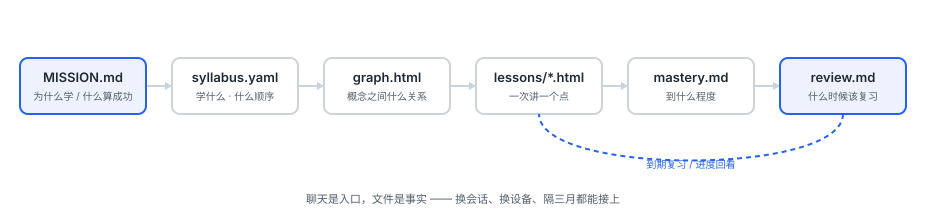
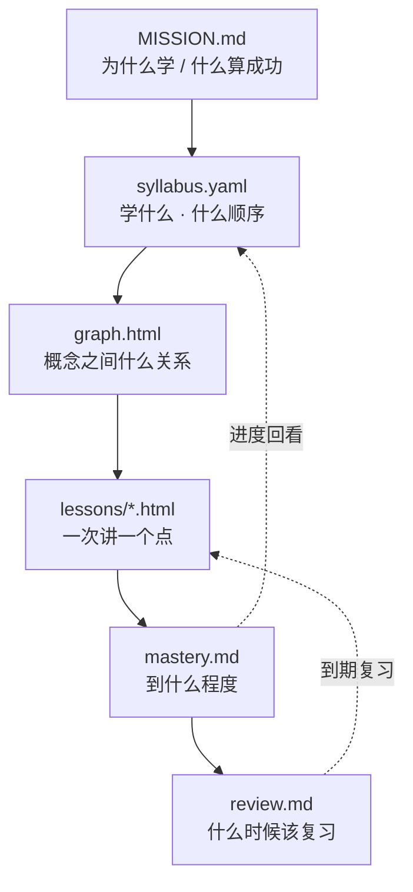
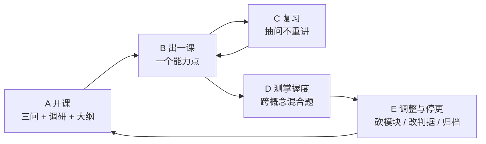
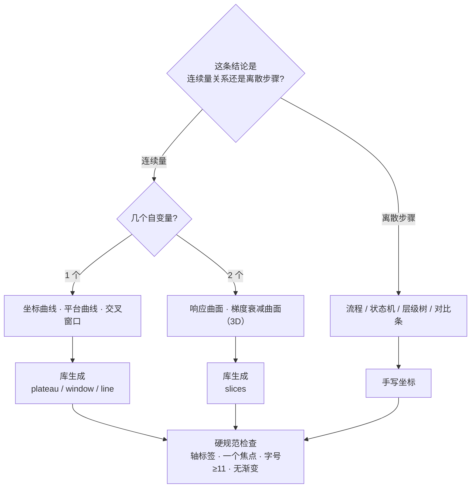
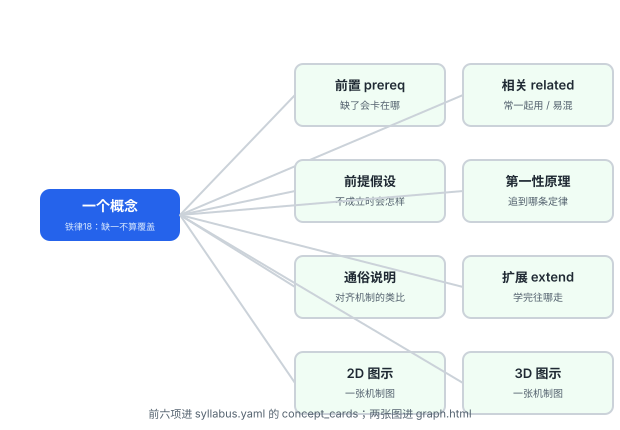
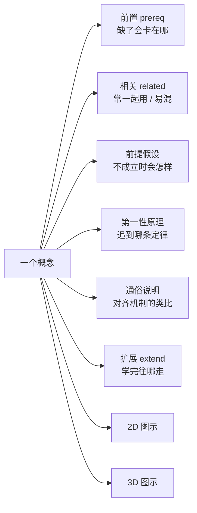
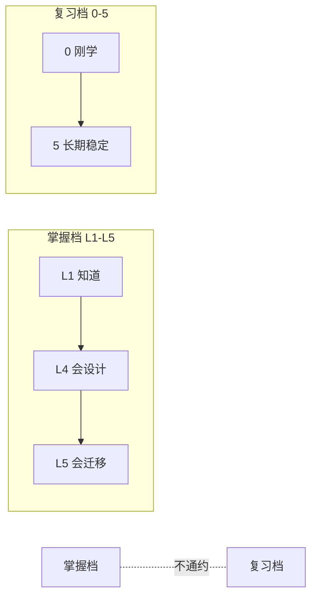

# learn-system · 体系学习控制器

> 版本：v0.9.2 · 一个让「学完一个领域」可追踪的 Agent Skill
> 它不教你知识，它管你把一件事学完：**学什么、什么顺序、到什么程度、什么时候该复习**。

---

## 一、它解决什么问题

跟 AI 聊天学东西，三件事一定会崩：

1. **学乱了**——今天问注塑，明天问缺陷，后天回来它已经不记得你学到哪
2. **学飞了**——每次都是「从入门到精通」的第一页，永远在开头
3. **学假了**——你觉得懂了，但没有一处能证明你真的会

这三件事的解法不是「更聪明地讲」，是**把状态写进文件**。所以这个技能只做一件事：

> **把「学完一个领域」做成一个可追踪的工程——前置依赖大纲 + 单点课 + 概念级掌握度 + 复习队列，四件套同时在线。**

判断要不要用它，只有一条标准：**有没有「跨多轮 + 要知道自己学到哪」的需求**。只想弄懂一个概念，直接问，不该用它。

---

## 二、四层结构（概念图）

聊天是入口，**文件是事实**。换会话、换设备、隔三个月，读 `mastery.md` 顶部三行就能接上。





---

## 三、五个环节（概念图）



每个环节都有明确的**停等点**：走完一段就停下来等反馈，不自己往下冲。

---

## 四、一张图该长什么样（概念图）

这是 v0.8.5 之后新增的一层：**课内的图必须讲「为什么」，不是装饰**。



**九种图型，每种绑定一个它必须回答的问题**——答不出就不许画：

| 图型 | 回答的问题 |
|---|---|
| 坐标曲线 | 一个量随另一个量怎么变？ |
| 平台/饱和曲线 | 到哪一点之后再加投入就没用了？ |
| 交叉窗口 | 两个相反要求在哪里共存？ |
| 响应曲面（3D） | 两个变量一起变，结果怎么变？ |
| 梯度/衰减曲面（3D） | 某量沿某方向为什么越来越弱？ |
| 剖面/层叠 | 内部从外到内是什么样？ |
| 流程/状态机 | 有哪几步，顺序能不能换？ |
| 对比条 | A 和 B 差多少？ |
| 层级树/依赖图 | 谁是谁的前置？ |

每张图配一句固定句式，写不出就说明它只是把正文又画了一遍：

> **【这张图回答】问题。** 因为 机制，所以 结论。

**为什么值得为图花时间**：Mayer 多媒体学习研究里，图文并用的效应量约 d=0.75，和形成性评价、提取练习同一量级。但前提是图必须**符合一致性原则**——装饰性插图反而有害。

---

## 五、知识图谱：每个概念八项（概念图）

大纲告诉你「学什么」，图谱告诉你「它们之间什么关系、每个点到底是什么」。





**铁律 18：八项缺一不算覆盖。** 铁律 4 只管「这个词出现过」，本条管「这个概念讲清了」。

前六项落在 `syllabus.yaml` 的 `concept_cards`；两张图落在 `graph.html`（单文件、离线可开、可打印）。

---

## 六、两个刻度不能混（概念图）



- `mastery.md` 的 **L1-L5**：你学到什么程度（前置门槛是 L3）
- `review.md` 的 **0-5**：多久该复习一次

两者**不互相换算**。同一概念两处都要有行。

---

## 七、安装

```bash
# 方式一：解压到技能目录
unzip learn-system-vX.Y.Z.zip -d ~/.workbuddy/skills/

# 方式二：从源码目录复制
cp -r skill/learn-system ~/.workbuddy/skills/
```

装完确认：`~/.workbuddy/skills/learn-system/SKILL.md` 存在即可。

> **注意**：仓库副本（`skill/learn-system/`）和已安装副本是**两个独立文件树**。改了仓库不部署，跑的还是旧副本。`build.py` 会自动部署，审计的 U 段会逐文件比对，不一致直接 FAIL。

---

## 八、用法

### 8.1 开课

```text
你：我想系统学 注塑
它：（弹窗三问：为什么学 / 什么算成功 / 每周几小时，选项带代号）
你：A1 B1 C1 D2
它：（写 MISSION，做调研，出大纲 → 停下等你确认）
你：确认
它：（出知识图谱 graph.html → 停下等你看）
```

### 8.2 上课

```text
你：继续
它：（定位进度 → 先写状态 → 写一课 → 交课前逐项打勾贴证据 → 停下）
```

**一个能力点、一个练习、3-5 题零提示自检、一条主源链接、一个问老师入口、2D+3D 各一张机制图。**

### 8.3 复习与测试

```text
你：该复习什么      → 先报「今天到期 N 条」，再出抽问题（不重讲）
你：考考我          → 跨概念混合题，覆盖记忆/理解/应用/迁移
你：我学到哪了      → 进度表 + 三个最薄弱点 + 下一课
```

### 8.4 控制节奏

```text
你：太浅了          → 改大纲，记 learning-record
你：每周只能 1 小时 → 重算预算，砍模块而不是压缩单模块
你：一个月没学了    → 逾期判定：3 周改判据 / 6 周归档，不假装还在学
```

---

## 九、20 个使用实例

| # | 你说什么 | 它做什么 | 你拿到什么 |
|---|---|---|---|
| 1 | 我想系统学 注塑 | 弹窗三问（代号 A/B/C/D，点确认回传）→ 教材+标准调研 → 大纲 → 图谱 | 5 个文件 + 带前置依据的大纲 + 26 概念图谱 |
| 2 | 继续 | 先定位进度（两个位置都扫、不向上找）→ 先落状态再写正文 | 一个可打印的 HTML 课 + 自检题 |
| 3 | 我读完了，但冷却时间那段没看懂 | 回到那个概念重讲，**不重出整课** | 一段补充说明 + 更新后的掌握档 |
| 4 | 我答完了，第 3 题错了 | 按证据表回填掌握档，记错误 | L2 + 证据 + 一条复习入队 |
| 5 | 该复习什么 | 先报「今天到期 4 条」，按逾期最久排序 | 4 道抽问题（不重讲） |
| 6 | 考考我 | 跨概念混合题，覆盖记忆/理解/应用/迁移 | 8-10 题 + 三个最薄弱点 |
| 7 | 我学到哪了 | 读 mastery.md 顶部三行 + 掌握档表 | 一张进度表 + 下一课是什么 |
| 8 | 太浅了 | 改大纲：加深度或换模块，记 learning-record | 修订后的大纲 |
| 9 | 赶不上，每周只能 1 小时了 | 重算预算 → 砍模块而不是压缩单模块 | 缩减版大纲 + 新到期日 |
| 10 | 我一个月没学了 | 逾期判定：3 周 → 改判据 | 一条明确处置，不假装还在学 |
| 11 | 给我看看这门课的图谱 | 渲染 graph.html：依赖图 + 每概念八项 | 一张能打印的知识地图 |
| 12 | 冷却时间的前提假设是什么 | 读概念卡 `assumption` 字段 | 一句话前提 + 不成立会怎样 |
| 13 | 冷却时间用第一性原理讲一遍 | 读 `first_principle`：追到传热定律 | 从定律推到结论的链条 |
| 14 | 讲得再通俗点 | 换一个**对齐机制**的类比（不是换个说法） | 一个生活类比 |
| 15 | 这个概念学完能往哪走 | 读 `extend` 字段 | 具体技术/章节，不是「深入学习」 |
| 16 | 把图谱导成 PDF | 浏览器打印 graph.html（已做 print 样式） | 一份 PDF 知识地图 |
| 17 | 帮我把这门课导成手册 | **建议切** `knowledge-handbook-builder`；切不成用 `reference/` 出速查件 | 速查件或手册 |
| 18 | 我在另一个目录下说「继续」 | 扫当前目录 + 兜底目录，不向上找；多个命中会问你 | 找回原来的课题，不会重开 |
| 19 | 接管我之前的 teach 进度 | 检测到 signals 且无 syllabus.yaml 时问一句，接管后把旧资产当已有 | 继承的 lessons + records |
| 20 | 这个知识点你确定对吗 | 断言分级：事实带锚点 / 建议标明 / 推断带可推翻条件 | 每句都有级别，能查证 |

**另外三条与图有关**：

| # | 你说什么 | 它做什么 |
|---|---|---|
| 21 | 这段我看不懂，来张图 | 按九种图型选型，用库生成（不手算坐标），配「这张图回答…」句式 |
| 22 | 为什么壁厚翻倍时间不是翻倍 | 选「坐标曲线」，画凸增曲线并标 δ / 2δ 对比 |
| 23 | 这两条规律的代价怎么权衡 | 选「交叉窗口」，画两条反向曲线 + 中间窗口带 |

---

## 十、知识正确性怎么保证（四关）

它不能保证知识一定对，但能让**错误变便宜**——四道关，每道都留下可查痕迹：

| 关 | 做什么 | 落下什么 |
|---|---|---|
| **来源关** | 教材目录 + 课程标准 + 现行标准做基准，6 级来源分级 | `syllabus.yaml` 的 `anchor` 与 `resources` |
| **断言关** | 每句话分三级：事实（带小节级锚点）/ 建议 / 推断（写可推翻条件） | 课内 `<span class="tag">` 标记 |
| **覆盖关** | 每个 `concepts` 必须出现在某课；与教材目录做差集，没讲的写 `not_covered` + 理由 | `syllabus.yaml` 的 `coverage_gap` |
| **抽查关** | 每课给「30 秒内你能自己查证的三条」 | 课内 `.check` 区块 |

**它不做的事**：不生产原创知识、不编数值、不引用没读过的来源。拿不到一手材料就标「待核验」，并说清去哪查。

---

## 十一、图谱页四层：一眼看到「学到哪了」

`graph.html` 不是「一张大图 + 一堆卡片」，而是四层递进，**每一层只回答一个问题**：

| 层 | 内容 | 图型 | 回答 | 预算 |
|---|---|---|---|---|
| 一 | 模块级总览 | 层叠（S1） | 模块之间的顺序是什么 | 5 个节点 |
| 二 | 学习路径 | 列表 + 三态 | 现在到哪了、下一站是哪个 | — |
| 三 | 掌握度热力图 | 热力图（S7） | 26 个概念分别落在哪一档 | 12×8 格 |
| 四 | 模块细节 | 依赖图（S9） | 这个模块内部谁先谁后 | 每模块 ≤9 节点 |

**为什么要把原来那张 26 节点的图拆掉**：它超了「单图 ≤9 节点」这条预算三倍。
把所有概念画在一张图上，看起来「全」，实际看不出主干——这是全局图最常见的失败方式。
现在模块级 5 个节点看顺序，概念级一个模块一张，各看各的。

**热力图的读法**：格内是**概念数**，不是分数。整列都是 0 不是记录缺失，是还没到那个阶段。
「未评」这一列有数字，说明课上过了但自检没答——**这正是最该被看见的一列**。

## 十二、自检：258 项审计

```bash
python learn-system-audit.py       # 主审计：258 项，退出码非 0 即 FAIL
python tools/review_dialog.py      # 弹窗专项 T 段（24 项）
python tools/review_graph.py       # 图谱专项 V 段（34 项）
python tools/review_compose.py     # 组合专项 Y 段（14 项）
python tools/review_compose_deep.py # 组合深度 Z 段（17 项）
python tools/review_side_effects.py # 副作用 AA 段（14 项）
python tools/review_visual.py      # 图面语法 AC 段（25 项）
python tools/review_regress.py     # 回归 X 段（13 项）
python tools/review_figspec.py     # 图型语法 AB 段（19 项）
python tools/count_checks.py       # 兜底：文档宣称项数 == 实际 PASS 数
```

覆盖：包完整性、frontmatter、18 条铁律交叉引用、跨文件术语一致、`syllabus` 结构（DAG 无环/预算/概念卡/产物登记/type 枚举/path 存在性）、模板无断链、工作区产物（课/速查/掌握度/复习/日期算术/图型规范）、HTML 合法性、弹窗 24 项、图谱 34 项、回归 13 项、组合 14+17 项、副作用 14 项、图型 19 项、双副本一致性。

**`count_checks.py` 挂在打包前门禁上**：文档说的项数 ≠ 实际跑的项数，`build.py` 直接拒绝出包。

---

## 十三、能和其他技能组合吗（能）

它不是孤岛。**借力时控制权不转移**——别的技能只产内容，掌握度和复习队列只由它写。

| 什么时候 | 要什么 | 谁产 | 落在哪 |
|---|---|---|---|
| 没懂，连续 2 次 | 深讲卡（动画 / 白板分解） | 借 `visual-knowledge-tutor` | `reference/<概念>深讲.html` |
| 懂了想用 | 速查件 | 自己 | `reference/<概念>速查.html` |
| 要交付 | 模块手册 | 借 `knowledge-handbook-builder` | `handbook/` |
| 要复习 | 抽认卡 | 自己从 mastery+review 派生 | `reference/抽认卡.html` |
| 通勤听 | 音频 | 借 TTS | `reference/audio/` |

### 四条组合铁律

1. **控制权不转移**：`mastery.md` / `review.md` 只由本 skill 写
2. **派活必须给已落盘输入**：不许口述「讲讲萃取率」，要给概念卡
3. **产物必须登记**：写进 `syllabus.yaml` 的 `artifacts`，否则下个会话等于不存在
4. **格式不归一就不硬塞**：外来 HTML 放 `reference/`，**不要塞进 `lessons/`**

---

## 十四、明确不做

| 不做 | 原因 |
|---|---|
| 不生产知识 | 只做结构化、锚定、验收；错了能查回去 |
| 不做单概念讲解 | 那是 `visual-knowledge-tutor` 的活；切不成自己也能讲，但**不建 `study/`** |
| 不**自己**做交互课件 / 大屏 | 可借力 `teachany` 产到 `reference/`（依赖图谱自己产，不外派） |
| 不在聊天里留状态 | 聊天会丢，文件不会 |
| 不一次批量出十课 | 铁律 1：一次只产出一课，出完停下等反馈 |
| 不靠时间戳猜你要学哪个课题 | 多个命中就问你，不自己判断 |
| 不画装饰性插图 | 一致性原则：无关插图反而降低学习效果 |
| 不给「每毫米壁厚对应几秒」这类通用系数 | 数值随材料、模温、水路变化，通用值反而误导 |

---

## 十五、版本与构建

```bash
python build.py              # 递增 patch → 同步文档版本号 → 部署到已装副本 → 门禁校验 → 打 zip
python build.py --bump minor
python build.py --no-bump    # 只部署+打包
python learn-system-audit.py # 全量校验，退出码非 0 即 FAIL
```

`VERSION` 是版本号唯一真源。

**已知局限**（技术手册里有完整列表）：`dist/` 里的旧版本包不是历史快照——`build.py` 每次都从当前源码重打，只有版本号不同。要回退得从 git tag 重新构建。

---

## 许可

MIT。欢迎提 issue，但请附上「用什么话题、第几课、哪一段没讲清」——那是唯一能改进它的输入。
